# BMSCE Room Management

Classroom allotment for the Department of Machine Learning, BMSCE. Students see which room is used by whom in every slot. Faculty request free rooms or drop a class. The HoD and Time Table Officers approve requests and take rooms for CIEs and college events.

**Stack:** Next.js 15 (App Router) + Tailwind CSS 4 on Vercel, Supabase (Postgres, Google sign-in, file storage). All on free tiers.

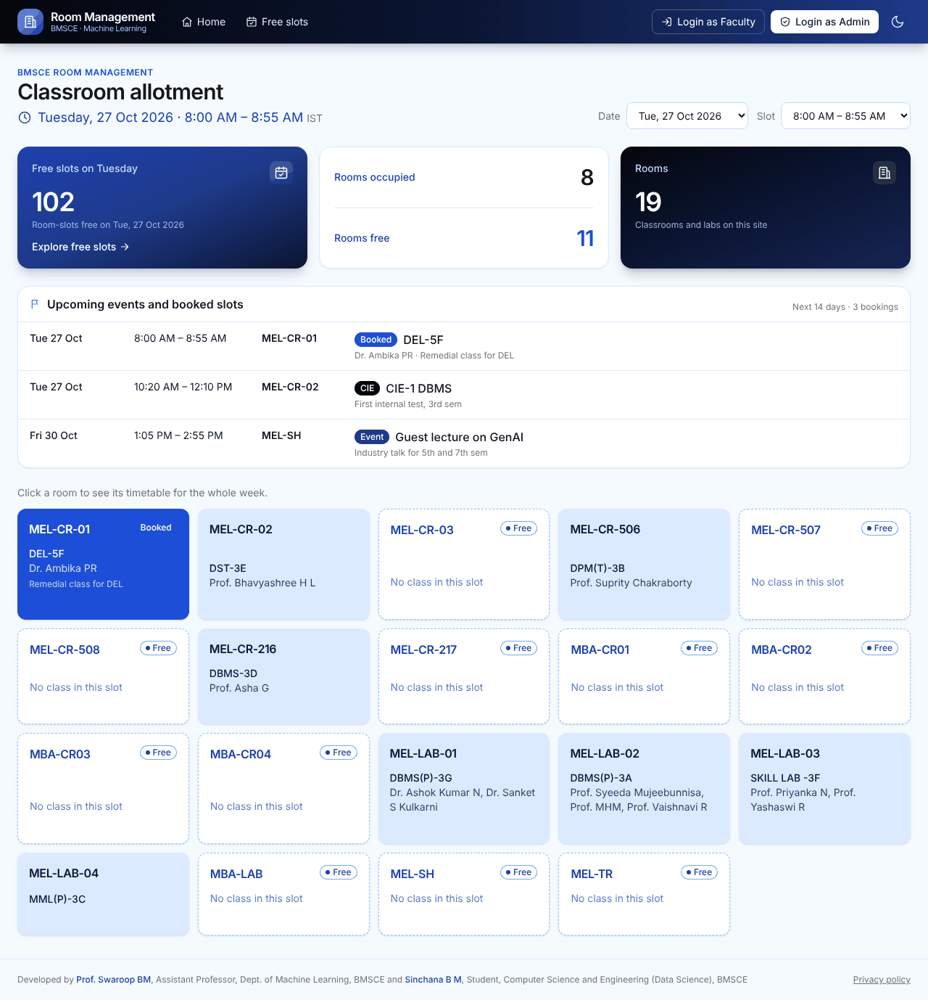

<sub>Screenshots use demo data.</sub>

## Contents

- [Features](#features)
- [What each role can do](#what-each-role-can-do)
- [How the data works](#how-the-data-works)
- [Deploying](#deploying-about-30-minutes-once)
- [Updating the timetable](#updating-the-timetable)
- [Subjects](#subjects)
- [Holidays](#holidays)
- [Local development](#local-development)

## Features

### For everyone (no sign-in)

- **Home:** pick a date and slot to see every room's subject and faculty member, how many rooms are free, and the events, CIEs and extra classes coming up in the next 14 days, each as its own card.
- **Room week view:** click any room to see its whole week, Monday to Saturday.
- **Slot requests:** click any slot to see who has requested it, for what, and where each request stands. Slots with pending requests show a count.
- **Free slots:** every free room for each slot of a day, so you can find a room fast.
- Works on phones and has a light and a dark theme.

<table>
  <tr>
    <td width="68%">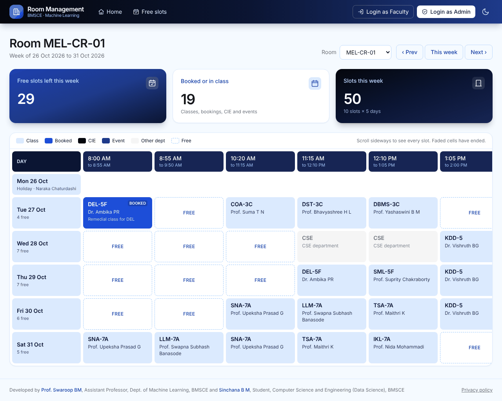</td>
    <td width="32%">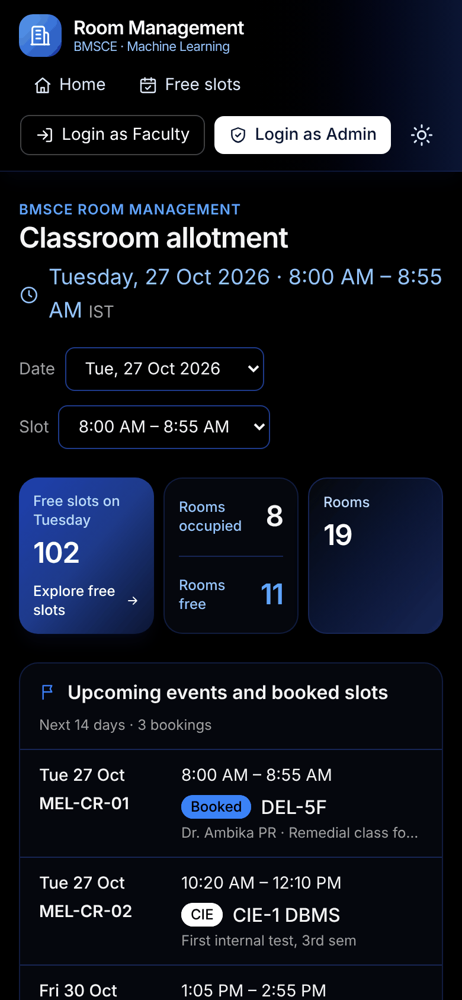</td>
  </tr>
</table>

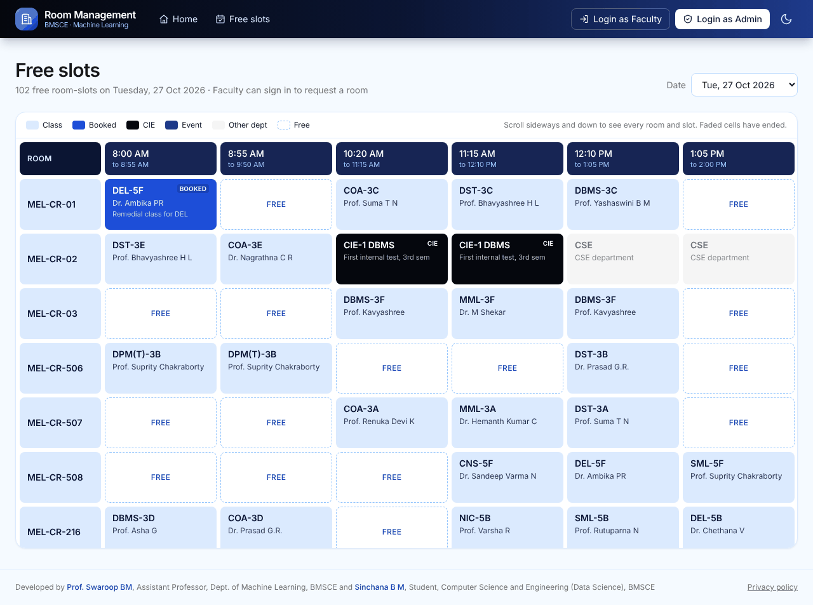

### For faculty

- **Request a room:** pick one slot or several in a row, then choose a class (for one of your allotted subjects) or an event (with the permission letter as a PDF under 5 MB; the form says it is mandatory, and the admin can reject an event request sent without it).
- **My dashboard:** your upcoming classes for the next 7 days, with a button to drop one, and your requests, with a button to withdraw a pending one.

| Request a room | My dashboard |
| --- | --- |
| 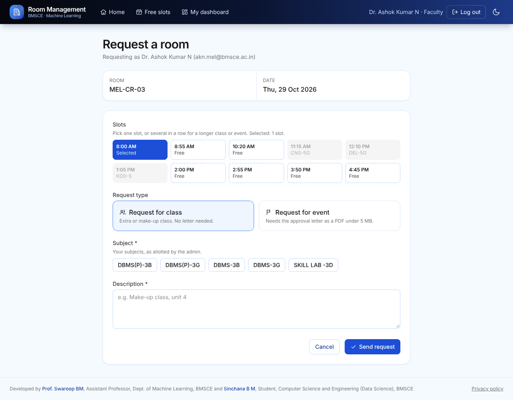 | 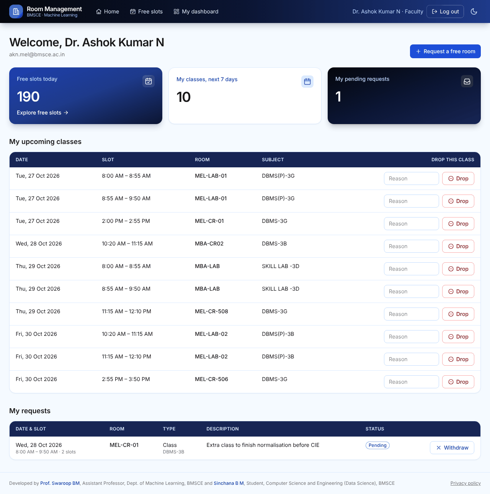 |

### For admins

- **Requests:** approve or reject in priority order. Approving a request declines the others for the same slots. Event requests sent without a permission letter are marked so you can reject them.
- **Allot / free rooms:** take a room for a CIE or event over a start-to-end time, free a room up, rename a booked class, event or CIE (from the upcoming changes list or by clicking the slot), or restore a slot to the timetable. The day-at-a-glance grid shows every room.
- **Edit timetable:** change single cells, upload a revised Word timetable (you see every change before it is saved), and add holidays.
- **Report:** events, CIEs, dropped classes and extra classes between two dates, ready to print with signature lines for HoD (Cluster A) and HoD (Cluster B), or as CSV.
- **Faculty timetables:** a card for every faculty member with their classes a week, other duties and free slots, and their full weekly timetable on a click. Classes come from the room timetable by initials; other duties (proctoring, committees) are added by hand or uploaded as a CSV.
- **Free time & meetings:** how many faculty are free in each slot, for Cluster A and Cluster B separately, who exactly is free, and the best meeting times (1 to 3 slots) for all faculty or a chosen group.
- **Subjects:** allot subjects to faculty by hand or straight from the timetable.
- **Faculty & admins:** admins first, then faculty, each with an add form. Initials are picked from the timetable so they always match.
- **History:** every change ever made, which nobody can edit.

| Requests | Allot or free a room |
| --- | --- |
| 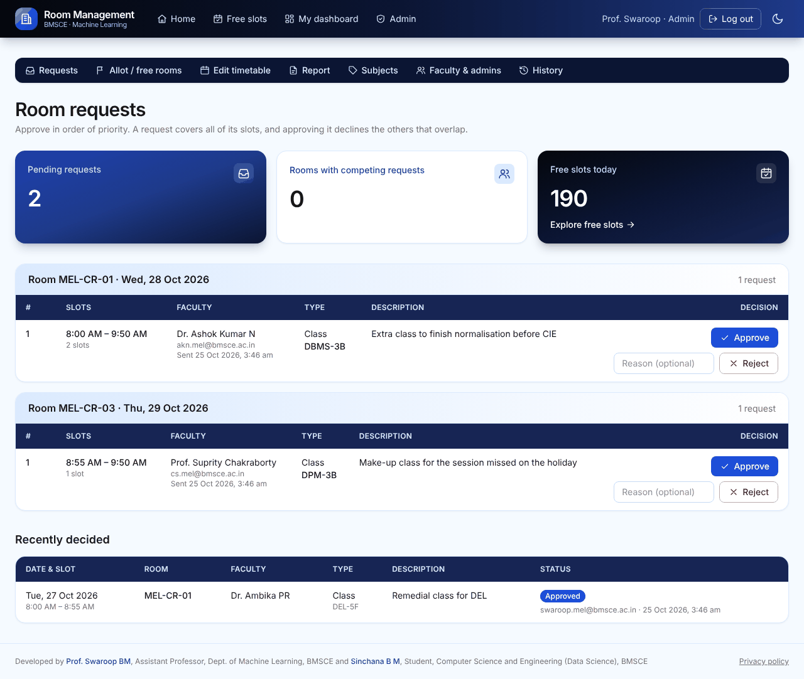 | 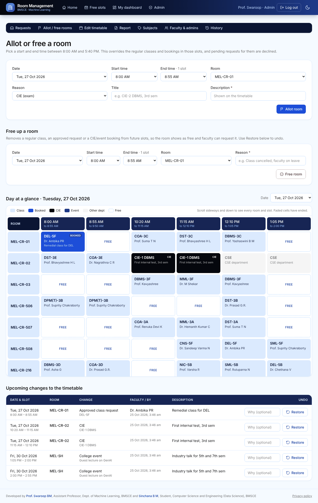 |

| Edit timetable and holidays | Report |
| --- | --- |
| 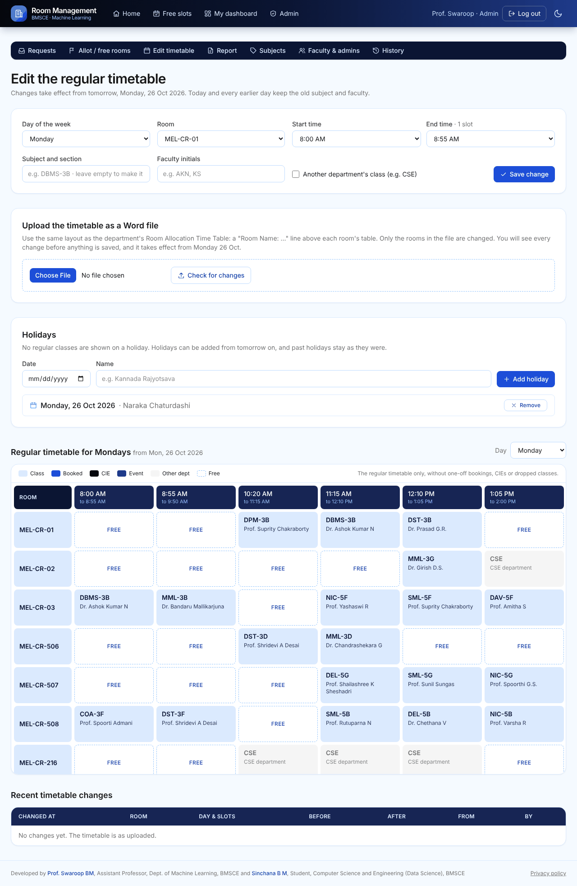 | 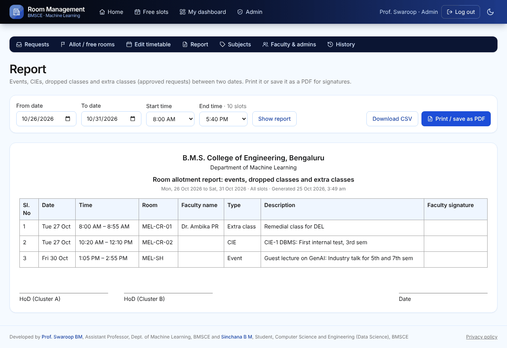 |

| Subjects | Faculty & admins |
| --- | --- |
| 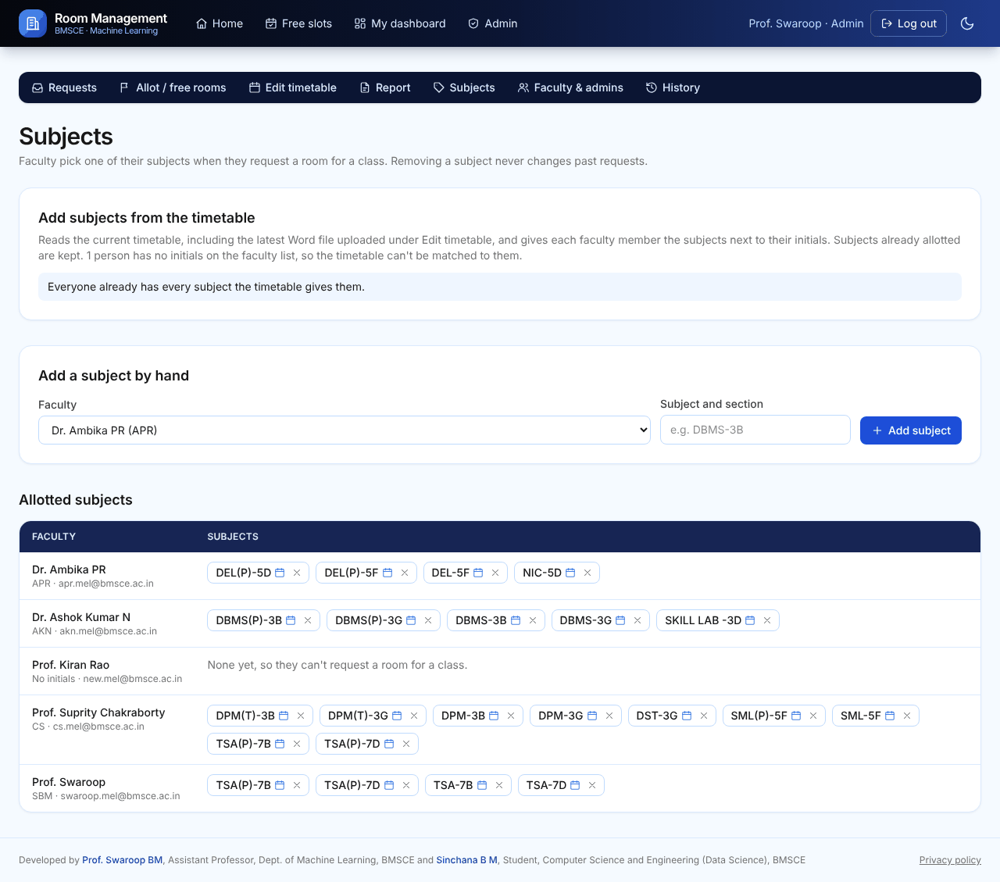 | 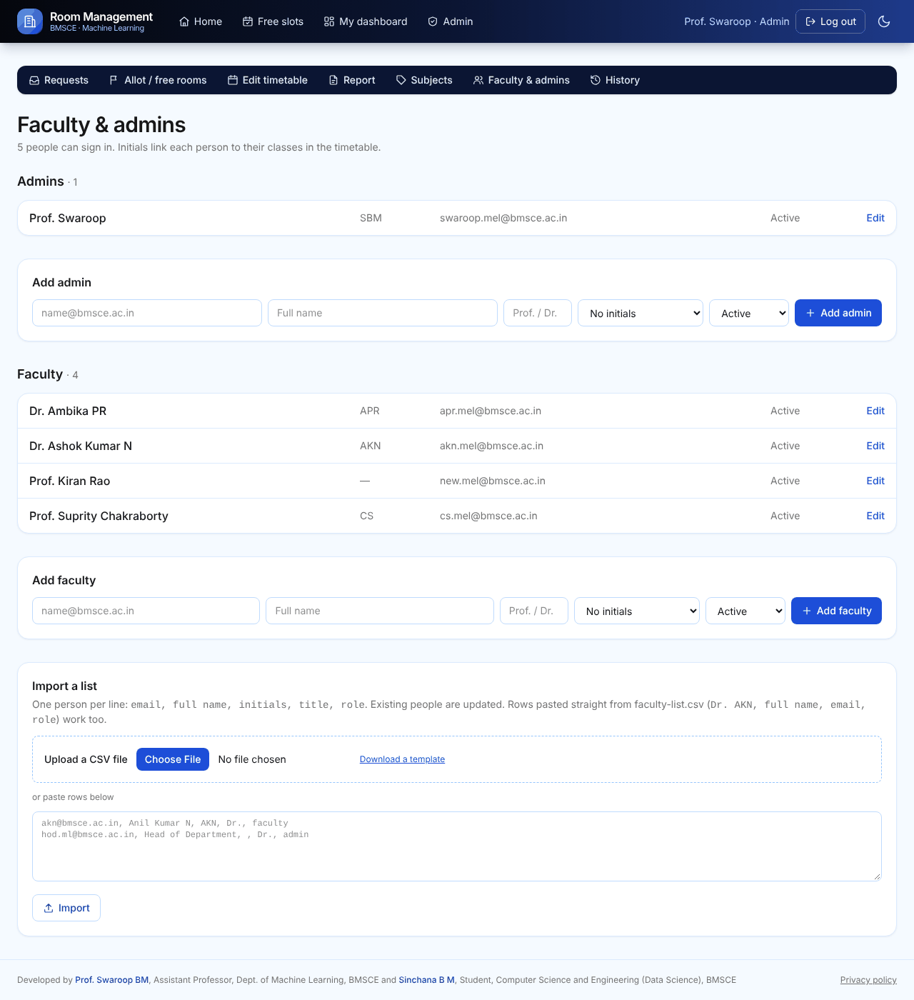 |

## What each role can do

| Role | Signs in? | Can |
| --- | --- | --- |
| Student | No | See every room's subject and faculty for any slot, the free slots, and the requests for each slot |
| Faculty | Google, @bmsce.ac.in, must be on the list | Request a **free** slot (class for one of their allotted subjects, or event with a PDF permission letter under 5 MB), see their requests, withdraw a pending one, drop one occurrence of their own class |
| Admin (HoD, Time Table Officers) | Same | Everything faculty can, plus approve or reject requests in priority order, allot any room for a CIE or event, rename a booked class, event or CIE, restore a slot to the timetable, manage the faculty/admin list, allot subjects to faculty, view the full history |

The [privacy page](src/app/privacy/page.tsx) on the site explains the same roles and what each can see.

## How the data works

- `timetable_entries` holds the weekly timetable imported from the department's Word file. A revised timetable is a **new version** starting today or later, so past days always show the timetable that applied then.
- `allotments` is an append-only log of every change to a (room, date, slot): approved requests, CIE/event overrides, dropped classes and restores. The latest row wins.
- `requests` holds faculty requests. Several requests per slot are allowed; approving one declines the rest. Anyone can see the requests for a slot (name, type, subject, description and status) by clicking it; email addresses, letters and the admin's notes stay private.
- **Past data is locked in the database itself.** Triggers reject any update or delete on `allotments` and the timetable, any change to a request once its slot has ended, and any new allotment for a slot that has ended. This applies to every account, admins included.
- Users never write to tables directly. Every action goes through a Postgres function that checks the caller's role (see `supabase/migrations/0001_init.sql`). Row-level security keeps email addresses and approval letters private; the public request list comes from `slot_requests`, which returns only the safe columns.
- Holidays have no classes, are left out of every date list, and cannot be booked from the website.
- All times are IST. Slots: 8:00, 8:55, 10:20, 11:15, 12:10, 1:05, 2:00, 2:55, 3:50 and 4:45 (55 minutes each), Monday to Saturday. Bookings open up to 4 weeks ahead.

## Deploying (about 30 minutes, once)

### 1. Supabase (database and login)

1. Sign up at [supabase.com](https://supabase.com) with GitHub and create a project. Pick the **Mumbai (ap-south-1)** region and save the database password somewhere safe.
2. Open **SQL Editor** and run these files one after another, pasting the whole of each: `supabase/migrations/0001_init.sql`, `supabase/migrations/0002_faculty_directory.sql` (full names for the timetable initials), `supabase/migrations/0003_multi_slot_requests.sql` (requests covering several slots in a row), `supabase/migrations/0004_admin_slot_range.sql` (admins allot a start-to-end range), `supabase/migrations/0005_admin_free_slots.sql` (admins free up a room), `supabase/migrations/0006_reports_and_timetable_edits.sql` (reports and timetable edits), `supabase/migrations/0007_holidays_and_timetable_upload.sql` (holidays and Word timetable upload), `supabase/migrations/0008_faculty_subjects.sql` (subjects for class requests), `supabase/migrations/0009_upcoming_bookings.sql` (upcoming events on the home page), `supabase/migrations/0010_public_slot_requests.sql` (anyone can see a slot's requests), `supabase/migrations/0011_optional_letter_and_rename.sql` (optional event letter, renaming bookings), `supabase/migrations/0013_faculty_timetables.sql` (faculty timetables and duties), then `supabase/seed.sql` (rooms, slots and the timetable).
3. Still in the SQL Editor, add yourself as the first admin (use your real email and name):
   ```sql
   insert into public.people (email, full_name, title, role)
   values ('your.name@bmsce.ac.in', 'Your Name', 'Prof.', 'admin');
   ```
   Everyone else can be added later from the website (**Admin → Faculty & admins**, including a bulk import that accepts `faculty-list.csv` rows).
4. Go to **Project Settings → API** and copy the **Project URL** and the **anon public** key.

### 2. Google sign-in

1. In [Google Cloud Console](https://console.cloud.google.com), create a project, then open **APIs & Services → OAuth consent screen**. Choose **External**, fill in the app name and your email, and click **Publish app** (basic sign-in needs no Google review).
2. **Credentials → Create credentials → OAuth client ID → Web application.** Under *Authorized redirect URIs* add `https://<your-project-ref>.supabase.co/auth/v1/callback`.
3. In Supabase, open **Authentication → Sign In / Providers → Google**, turn it on, and paste the client ID and secret.

### 3. Vercel (website hosting)

1. Sign up at [vercel.com](https://vercel.com) with GitHub, click **Add New → Project**, and import this repository.
2. Add the two environment variables from `.env.example` with the values from step 1.4, then **Deploy**.
   Optional, for a cleaner Google sign-in screen: also add `NEXT_PUBLIC_GOOGLE_CLIENT_ID` (your Google web client's Client ID), and in Google Cloud add your Vercel address under the client's **Authorized JavaScript origins**. Without it, sign-in still works but Google shows the Supabase address.
3. Back in Supabase, open **Authentication → URL Configuration**. Set **Site URL** to your Vercel address (e.g. `https://room-management.vercel.app`) and add `https://room-management.vercel.app/**` under **Redirect URLs**.

### 4. Optional: keep Supabase awake in holidays

Supabase pauses free projects after 7 days with no visits. In GitHub, open **Settings → Secrets and variables → Actions** and add `SUPABASE_URL` and `SUPABASE_ANON_KEY`; the included workflow then pings the database every 3 days.

## Updating the timetable

The easiest way: sign in as an admin, open **Admin → Edit timetable**, and upload the revised Word file under "Upload the timetable as a Word file". The site lists every cell that would change, and nothing is saved until you click **Apply**. Changes take effect from tomorrow; only the rooms in the file are touched, and earlier days keep the old timetable. Single cells can be edited on the same page.

Or, from the command line, generate the revision as the next version, starting today or later:

```bash
pip install python-docx
python3 scripts/parse_timetable.py "Revised Timetable.docx" --version 2 --from 2026-11-02 > revision.sql
```

Run `revision.sql` in the Supabase SQL Editor. From that date on the new timetable applies; past days keep the old one, and the database refuses a revision that starts in the past.

## Subjects

A class request names one of the faculty member's subjects (e.g. `DBMS-3B`). Admins allot them under **Admin → Subjects**, either by hand or with **Add subjects from the timetable**, which gives everyone the subjects next to their initials in the current timetable (including a newly uploaded Word file). Faculty with no subjects can still request rooms for events. Removing a subject never changes past requests, and an approved class shows its subject in the timetable.

## Holidays

Admins add holidays under **Admin → Edit timetable**, from tomorrow on. A holiday shows no classes, is left out of every date dropdown, and shows as an empty row in a room's week view. Past holidays stay as they were.

## Local development

```bash
cp .env.example .env.local   # fill in your Supabase values
npm install
npm run dev
```

## Getting found on Google

1. Open [Google Search Console](https://search.google.com/search-console), add a **URL prefix** property for your site address, and pick **HTML tag** verification.
2. Copy only the `content="…"` value into a Vercel environment variable named `GOOGLE_SITE_VERIFICATION`, redeploy, then click **Verify**.
3. Under **Sitemaps**, submit `sitemap.xml`. Google usually lists a new site within a few days to two weeks.

## Credits

Developed by Prof. Swaroop BM, Assistant Professor, Dept. of Machine Learning, BMSCE, and Sinchana B M, Student, Computer Science and Engineering (Data Science), BMSCE.
