# BMSCE Class and Classroom Management

Classroom allotment for the Department of Machine Learning, BMSCE. Students see which room is used by whom in every slot. Faculty request free rooms or drop a class. The HoD and Time Table Officers approve requests and take rooms for CIEs and college events.

**Stack:** Next.js 15 (App Router) + Tailwind CSS 4 on Vercel, Supabase (Postgres, Google sign-in, file storage). All on free tiers.

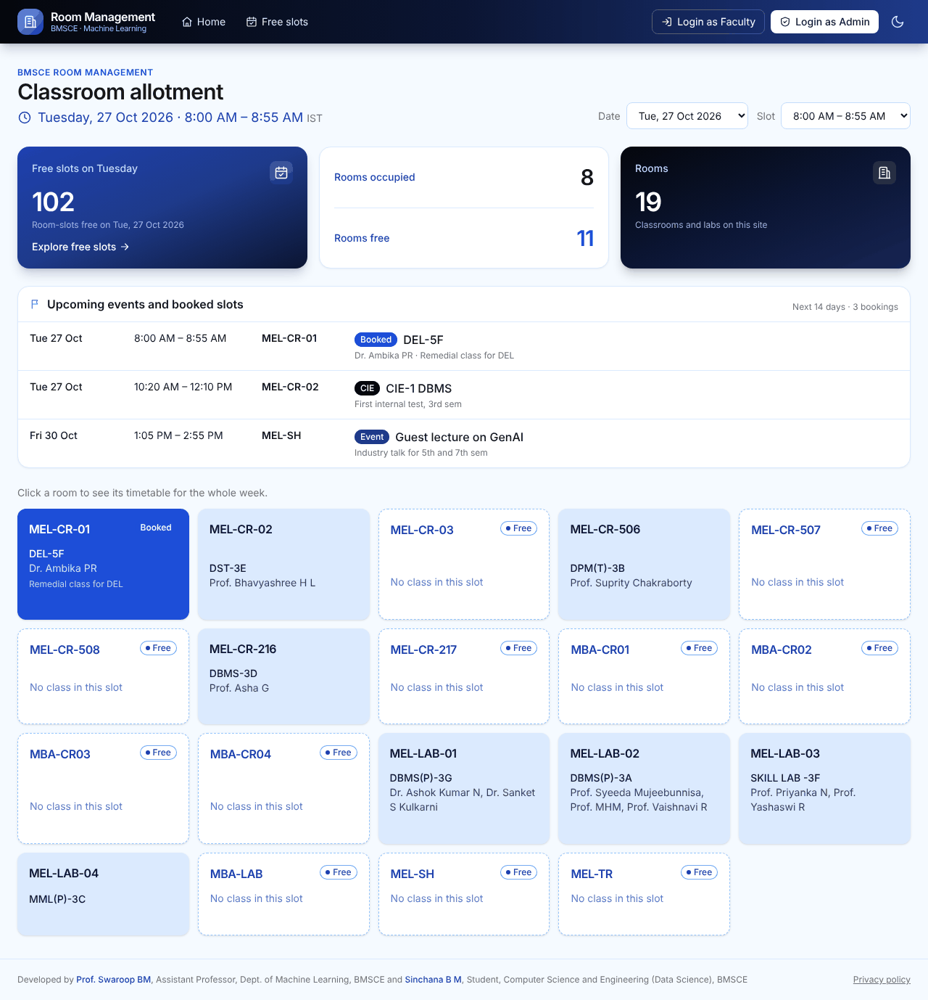

<sub>Screenshots use demo data.</sub>

## Contents

- [Features](#features)
- [What each role can do](#what-each-role-can-do)
- [How the data works](#how-the-data-works)
- [Deploying](#deploying-about-30-minutes-once)
- [Updating the timetable](#updating-the-timetable)
- [Subjects](#subjects)
- [Holidays](#holidays)
- [Local development](#local-development)

## Features

### For everyone (no sign-in)

- **Home:** pick a date and slot to see every room's subject and faculty member, how many rooms are free, and the events, CIEs and extra classes coming up in the next 14 days, each as its own card. When an event, CIE or booking takes the place of a regular class, the card also shows the original class, e.g. ~~DBMS-3B~~ · Dr. Ashok Kumar N replaced by an IEEE event. The room week, slot page and report show it too.
- **Search:** type a faculty name, initials or a class (e.g. `SBM`, `5A`) on the home page to see where they are in every slot of the day. A **Now** button jumps back to the current slot.
- **Class timetables:** each class's regular week, with subject, faculty and room.
- **Room week view:** click any room to see its whole week, Monday to Saturday.
- **Faculty availability:** the home page shows how many faculty are free and busy in the chosen slot. Click either to see who, for every slot of the day, by Cluster A and Cluster B.
- **Slot requests:** click any slot to see who has requested it, for what, and where each request stands. Slots with pending requests show a count.
- **Free slots:** every free room for each slot of a day, so you can find a room fast.
- Works on phones and has a light and a dark theme.

<table>
  <tr>
    <td width="68%">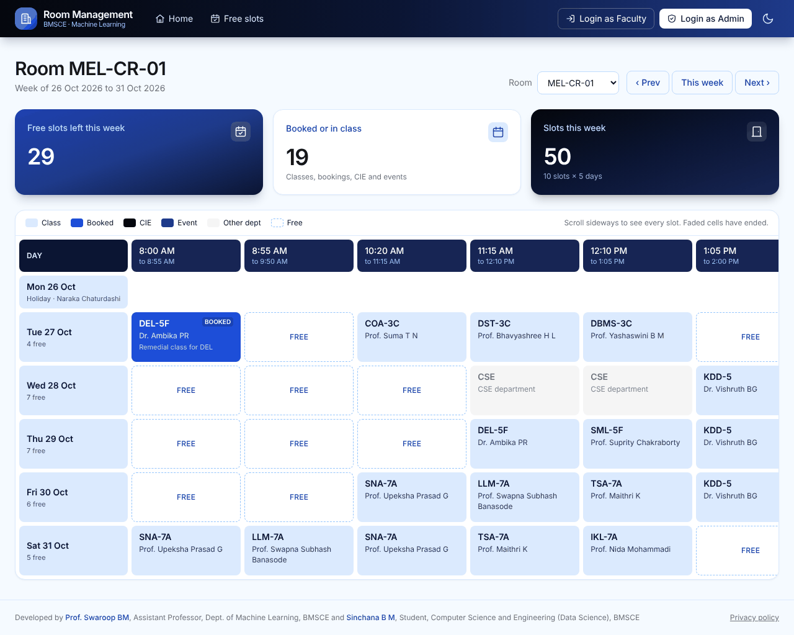</td>
    <td width="32%">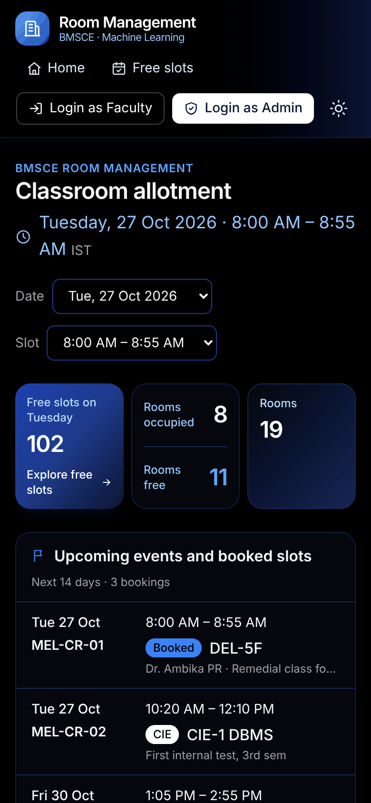</td>
  </tr>
</table>

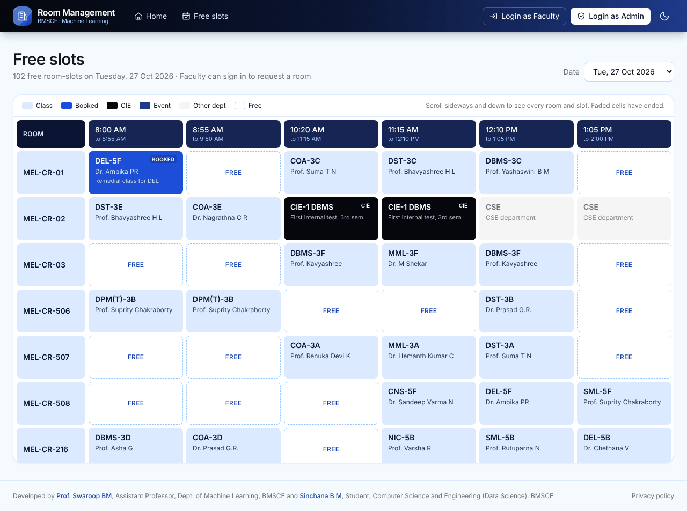

### For faculty

- **Request a room:** pick one slot or several in a row, optionally repeated weekly for up to 4 weeks, then choose a class (for one of your allotted subjects) or an event (with the permission letter as a PDF under 5 MB; the form says it is mandatory, and the admin can reject an event request sent without it).
- **My dashboard:** your upcoming classes for the next 7 days, with a button to drop one (and undo a drop until the class starts), your whole week (classes and other duties), and your requests, with a button to withdraw a pending one.
- **Clash warnings:** the request form warns if you already have a class or duty in that slot, or if the class's section is already in another class then.

| Request a room | My dashboard |
| --- | --- |
| 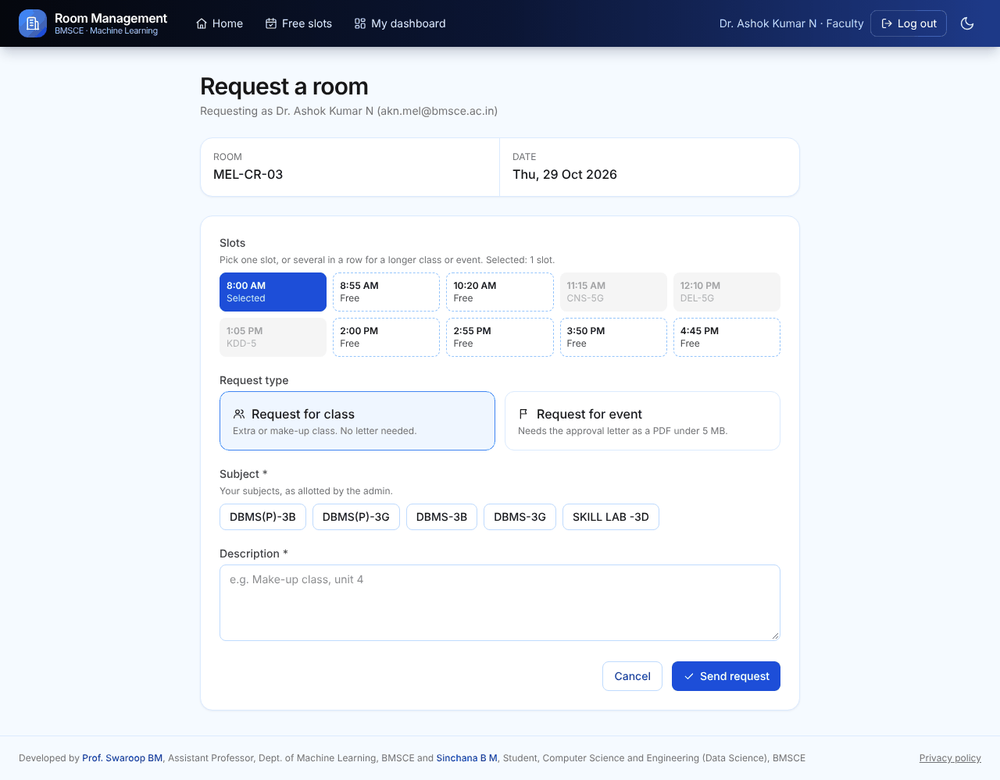 | 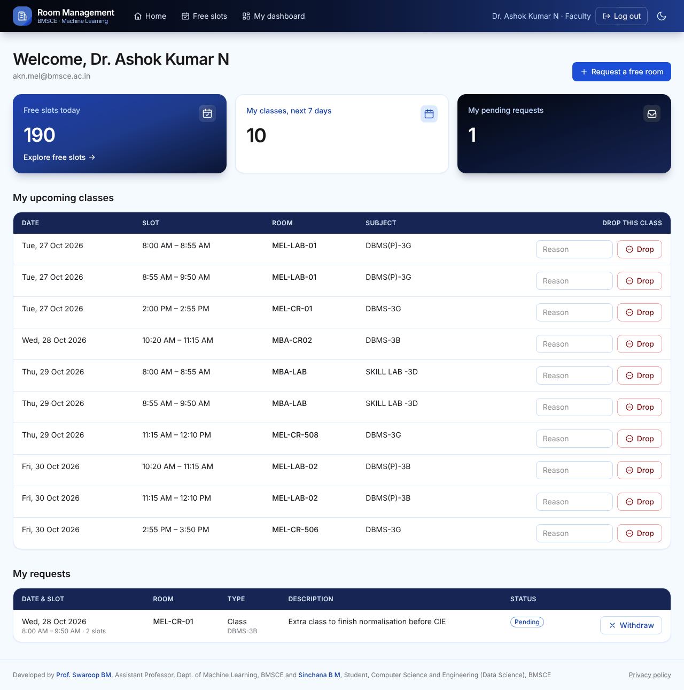 |

### For admins

The admin pages are in six groups: **Home**, **Requests** (room requests, class cover), **Rooms** (allot or free, bulk allotment, classes affected, upcoming events, room details, calendar), **Timetables** (room and class timetables with the health check, semester end and new semester), **Faculty** (profiles with the sign-in list, leave and substitutes, subjects), and **Records** (report, usage of rooms and faculty workload, activity log). **Help** in the top bar opens one manual: the faculty chapters for everyone, plus the admin chapters for admins. A page with several views, such as Bulk allot & events, shows them as tabs at the top.


- **Requests:** approve or reject in priority order, with a warning when the faculty member or the section already has a class in that slot. Approving a request declines the others for the same slots. Event requests sent without a permission letter are marked so you can reject them.
- **Allot / free rooms:** take a room for a CIE, an event or a class over a start-to-end time (a class names the faculty member who takes it, or says no faculty is assigned, and shows as theirs in My week and free/busy faculty), record a CIE, event or class on a past date so the records are complete (admins only; faculty can only request slots still to come), free a room up, rename a booked class, event or CIE (from the upcoming changes list or by clicking the slot), or restore a slot to the timetable. The day-at-a-glance grid shows every room.
- **Edit timetable:** change single cells, upload a revised Word timetable (you see every change before it is saved), and add holidays.
- **Class timetable:** each class's week (3A, 3B, … plus the whole-semester subjects), built from the room timetable. Click the pencil on a class to fix its subject, faculty initials or room (only free rooms are offered), with Save and Delete, or add a class to a free slot. Initials not in the faculty list are marked so typos stand out. Changes take effect from tomorrow, like every timetable edit.
- **Report:** events, CIEs, dropped classes and extra classes between two dates, ready to print with signature lines for HoD (Cluster A) and HoD (Cluster B), or as CSV.
- **Faculty profiles:** one place per faculty member for their name and initials, sign-in, cluster, subjects, other duties and weekly timetable. A card for every faculty member with their classes a week, other duties and free slots, and their full weekly timetable on a click. Classes come from the room timetable by initials; other duties (proctoring, committees) are added by hand or uploaded as a CSV.
- **Faculty availability:** one page with three tabs. Day: who is free or busy in each slot. Find a meeting time: the best times (1 to 3 slots) over the next six working days for the department, one cluster or a chosen group, open to every signed-in faculty member. Week (admins): how many faculty are free in each slot of the regular week. Faculty are put into clusters on the Faculty profiles page.
- **Subjects:** allot subjects to faculty by hand or straight from the timetable.
- **Faculty & admins:** admins first, then faculty, each with an add form. Initials are picked from the timetable so they always match.
- **Activity log:** every change, who made it and when, with a Bookings and decisions tab listing every allotment and rejected request, which nobody can edit.
- **Class cover:** every class handed to someone else in one list: class exchanges between faculty (approve or deny once the colleague accepts) and substitutes the admin assigned for leave.
- **Bulk allotment:** a CIE, SEE, event, skill lab or class in several rooms and times over a run of days, all or none. A CIE or SEE can cancel the classes of the semesters writing it. An event or skill lab names the sections attending ("Skill Lab - 3B/3D"): their own classes at its times are released. The preview lists what is already booked, the classes released and the classes of other sections that lose their room; after saving, Classes affected opens on those days.
- **Classes affected:** every class over the next 7 or 14 days whose room was taken by an event, a skill lab, a CIE or SEE, or a booking and that has not been moved, events first. A class whose sections are all elsewhere then (at the event, named in its name or description, at another event, or off for their CIE or SEE) is not listed. Each has up to four free rooms and times (its section free, a room of the right kind: a practical gets a free lab and a free classroom for each time, its faculty free then and in the slots just before and after). Move a class with one press, pick a room and time by hand (clashes are shown; "move anyway" for a section or faculty clash, never into a room in use), or move every ticked class at once with a bulk plan, events first, in which no two classes share a room. A printable sheet of every class moved between two dates can be saved as a PDF to share with faculty and students.
- **Upcoming events:** every event, skill lab, CIE and SEE in the next 14 or 28 days, with its days, rooms, sections and classes affected. Rename one or change its description on all its days, add sections attending (releasing their classes), or cancel it on one day or all, which puts its rooms and every class released, cancelled or moved for it back as they were.

| Requests | Allot or free a room |
| --- | --- |
| 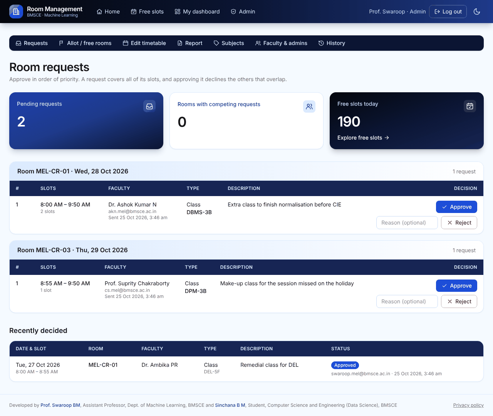 | 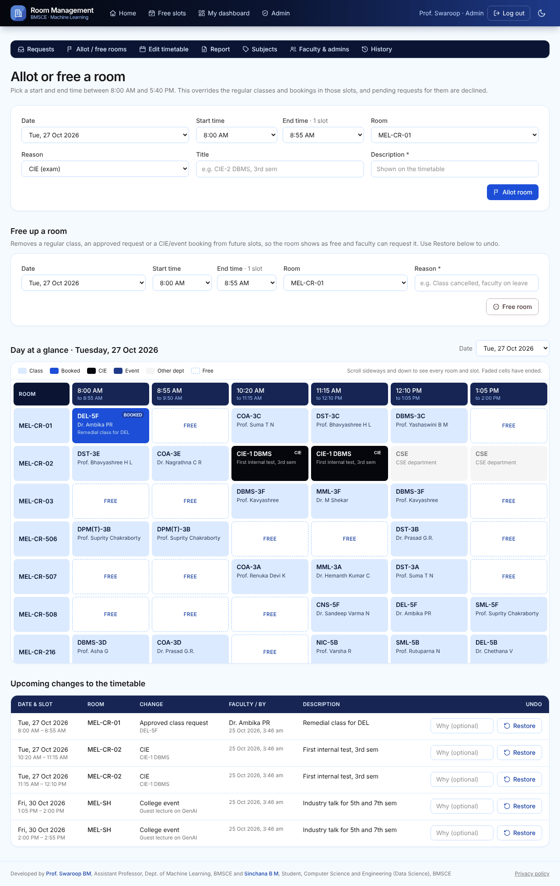 |

| Edit timetable and holidays | Report |
| --- | --- |
| 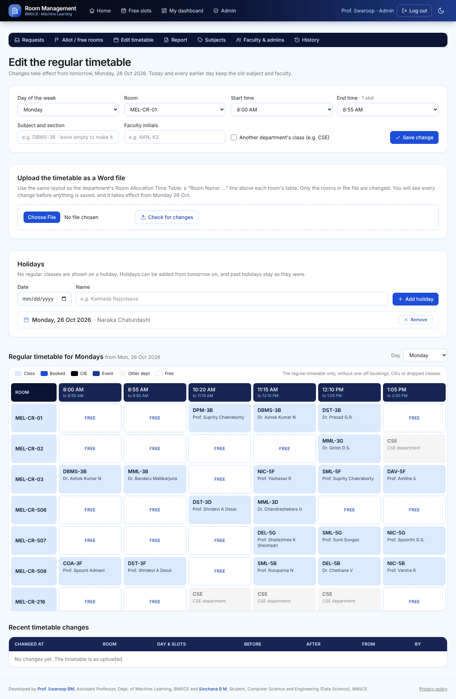 | 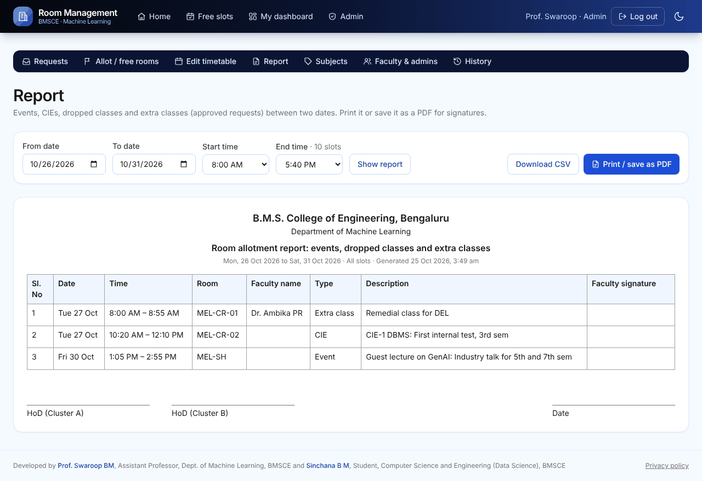 |

| Subjects | Faculty & admins |
| --- | --- |
| 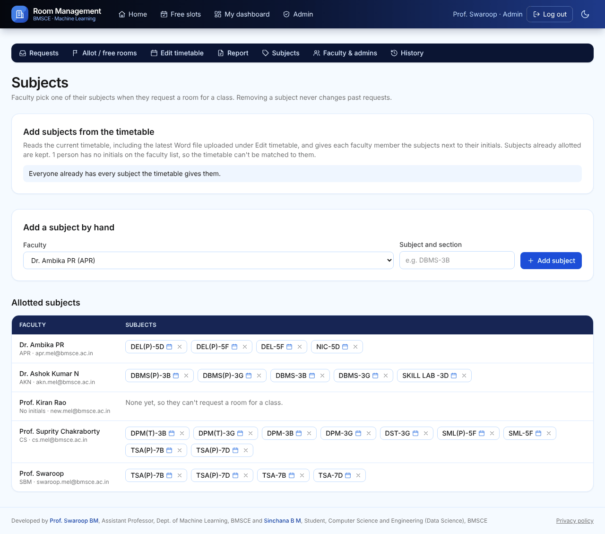 | 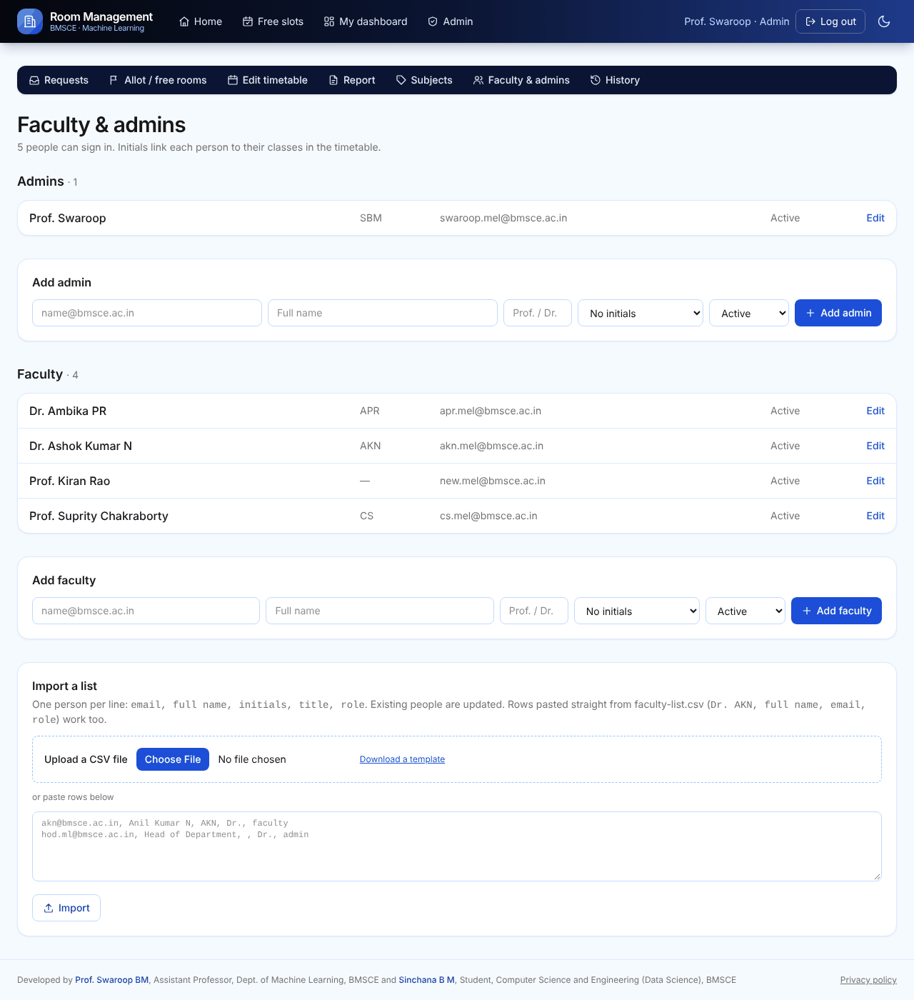 |

## What each role can do

| Role | Signs in? | Can |
| --- | --- | --- |
| Student | No | See every room's subject and faculty for any slot, the free slots, and the requests for each slot |
| Faculty | Google, @bmsce.ac.in, must be on the list | Request a **free** slot (class for one of their allotted subjects, or event with a PDF permission letter under 5 MB), see their requests, withdraw a pending one, drop one occurrence of their own class |
| Admin (HoD, Time Table Officers) | Same | Everything faculty can, plus approve or reject requests in priority order, allot any room for a CIE or event, rename a booked class, event or CIE, restore a slot to the timetable, manage the faculty/admin list, allot subjects to faculty, view the full history |

The [privacy page](src/app/privacy/page.tsx) on the site explains the same roles and what each can see.

## How the data works

- `timetable_entries` holds the weekly timetable imported from the department's Word file. A revised timetable is a **new version** starting today or later, so past days always show the timetable that applied then.
- `allotments` is an append-only log of every change to a (room, date, slot): approved requests, CIE/event overrides, dropped classes and restores. The latest row wins.
- `requests` holds faculty requests. Several requests per slot are allowed; approving one declines the rest. Anyone can see the requests for a slot (name, type, subject, description and status) by clicking it; email addresses, letters and the admin's notes stay private.
- **Past data is locked in the database itself.** Triggers reject any update or delete on `allotments` and the timetable, any change to a request once its slot has ended, and any new allotment for a slot that has ended. The one exception: an admin can add a record of a CIE, event or class that already took place (from Allot a room), so the department's records are complete. Faculty requests are always for slots still to come, and nothing already recorded can be changed.
- Users never write to tables directly. Every action goes through a Postgres function that checks the caller's role (see `supabase/schema.sql`). Row-level security keeps email addresses and approval letters private; the public request list comes from `slot_requests`, which returns only the safe columns.
- Holidays have no classes, are left out of every date list, and cannot be booked from the website.
- All times are IST. Slots: 8:00, 8:55, 10:20, 11:15, 12:10, 1:05, 2:00, 2:55, 3:50 and 4:45 (55 minutes each), Monday to Saturday. Bookings open up to 4 weeks ahead.

## Deploying (about 30 minutes, once)

### 1. Supabase (database and login)

1. Sign up at [supabase.com](https://supabase.com) with GitHub and create a project. Pick the **Mumbai (ap-south-1)** region and save the database password somewhere safe.
2. Open **SQL Editor** and run `supabase/schema.sql` (the whole database in one file), then `supabase/seed.sql` (rooms, slots and the timetable). Paste the whole of each file and press Run.
3. Still in the SQL Editor, add yourself as the first admin (use your real email and name):
   ```sql
   insert into public.people (email, full_name, title, role)
   values ('your.name@bmsce.ac.in', 'Your Name', 'Prof.', 'admin');
   ```
   Everyone else can be added later from the website (**Admin → Faculty & admins**, including a bulk import that accepts `faculty-list.csv` rows).
4. Go to **Project Settings → API** and copy the **Project URL** and the **anon public** key.

### 2. Google sign-in

1. In [Google Cloud Console](https://console.cloud.google.com), create a project, then open **APIs & Services → OAuth consent screen**. Choose **External**, fill in the app name and your email, and click **Publish app** (basic sign-in needs no Google review).
2. **Credentials → Create credentials → OAuth client ID → Web application.** Under *Authorized redirect URIs* add `https://<your-project-ref>.supabase.co/auth/v1/callback`.
3. In Supabase, open **Authentication → Sign In / Providers → Google**, turn it on, and paste the client ID and secret.

### 3. Vercel (website hosting)

1. Sign up at [vercel.com](https://vercel.com) with GitHub, click **Add New → Project**, and import this repository.
2. Add the two environment variables from `.env.example` with the values from step 1.4, then **Deploy**.
   Optional, for a cleaner Google sign-in screen: also add `NEXT_PUBLIC_GOOGLE_CLIENT_ID` (your Google web client's Client ID), and in Google Cloud add your Vercel address under the client's **Authorized JavaScript origins**. Without it, sign-in still works but Google shows the Supabase address.
3. Back in Supabase, open **Authentication → URL Configuration**. Set **Site URL** to your Vercel address (e.g. `https://room-management.vercel.app`) and add `https://room-management.vercel.app/**` under **Redirect URLs**.

### 4. Optional: keep Supabase awake in holidays

Supabase pauses free projects after 7 days with no visits. In GitHub, open **Settings → Secrets and variables → Actions** and add `SUPABASE_URL` and `SUPABASE_ANON_KEY`; the included workflow then pings the database every 3 days.

## Updating the timetable

The easiest way: sign in as an admin, open **Admin → Timetables → Room timetable**, and upload the revised Word file under "Upload the timetable as a Word file". The site lists every cell that would change, and nothing is saved until you click **Apply**. Changes take effect from tomorrow; only the rooms in the file are touched, and earlier days keep the old timetable. Single cells can be edited on the same page.

## Database schema

`supabase/schema.sql` builds the whole database for a new install. `supabase/migrations/` keeps every change in order (0001 onwards); a site that is already running applies only the new ones, in the SQL Editor, before the code that needs them is deployed.

After adding a migration, regenerate `schema.sql` from a database built from all the migrations, so new installs stay in step: `pg_dump --schema=public --schema-only --no-owner`, then keep the header, the faculty names and the storage section at the end of the current file.

## Subjects

A class request names one of the faculty member's subjects (e.g. `DBMS-3B`). Admins allot them under **Admin → Subjects**, either by hand or with **Add subjects from the timetable**, which gives everyone the subjects next to their initials in the current timetable (including a newly uploaded Word file). Faculty with no subjects can still request rooms for events. Removing a subject never changes past requests, and an approved class shows its subject in the timetable.

## Holidays

Admins add holidays under **Admin → Rooms → Calendar & notices**, from tomorrow on. A holiday shows no classes, is left out of every date dropdown, and shows as an empty row in a room's week view. Past holidays stay as they were.

## Local development

```bash
cp .env.example .env.local   # fill in your Supabase values
npm install
npm run dev
```

Before pushing, run the checks: `npm run lint`, `npm run typecheck` and `npm test`. The tests (in
`src/lib/__tests__`) cover the date helpers, class names, booking runs, the skill lab planner and
affected classes, using a small made-up day, so they need no database.

## Getting found on Google

1. Open [Google Search Console](https://search.google.com/search-console), add a **URL prefix** property for your site address, and pick **HTML tag** verification.
2. Copy only the `content="…"` value into a Vercel environment variable named `GOOGLE_SITE_VERIFICATION`, redeploy, then click **Verify**.
3. Under **Sitemaps**, submit `sitemap.xml`. Google usually lists a new site within a few days to two weeks.

## Credits

Developed by Prof. Swaroop BM, Assistant Professor, Dept. of Machine Learning, BMSCE, and Sinchana B M, Student, Computer Science and Engineering (Data Science), BMSCE.

With thanks to [Dr. Sandeep Varma N](https://bmsce.ac.in/home/facultyProfile/156/Dr-Sandeep-Varma-N), HoD, Department of Machine Learning, BMSCE, for mentoring the project.

## Writing a new migration

Postgres compiles a big query to machine code (JIT) when it guesses it will touch many rows, and for
this app's small reads that compile step costs far more than the query (about 0.8 s against 15 ms
for free and busy faculty). Migration 0027 turns JIT off for every function that returns rows.
`create or replace function` drops that setting, so add `set jit = off` to any function you
redefine that returns a table, next to `set search_path = public`.

